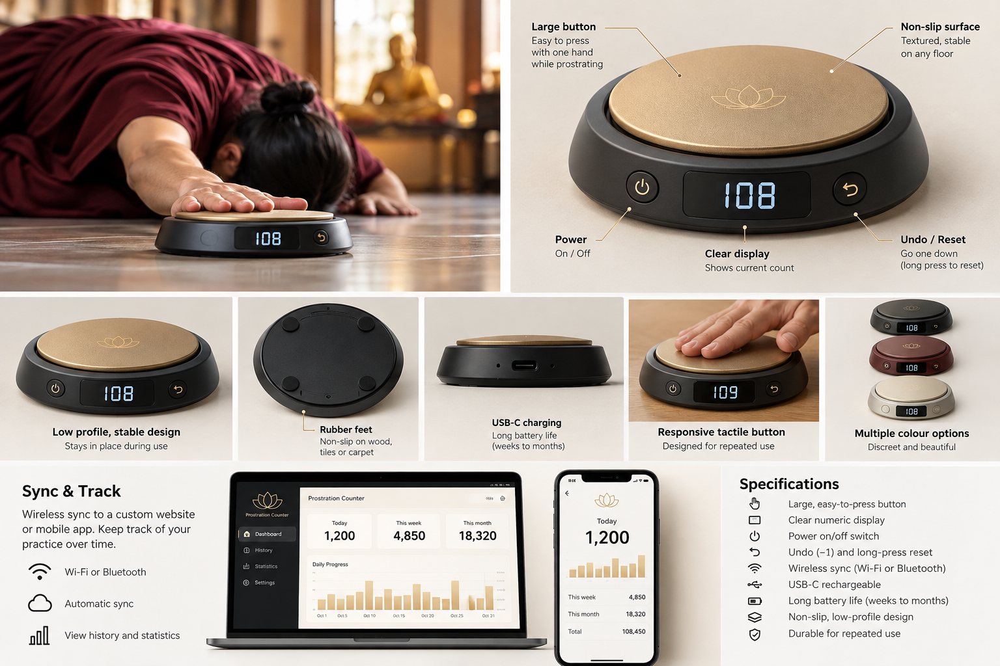

# Prostration Counter

A quiet, palm-sized floor button for Buddhist practitioners performing prostrations. One deliberate press records one prostration, a small display shows progress, and practice continues without a phone or internet connection.

**Status: concept and engineering specification, not an implemented or tested product.** This repository contains the original generated concept board and an MVP design package. There is no working firmware, dashboard, PCB, production CAD or validated battery-life result yet.

*Original AI-generated concept artwork, recovered from the preceding design conversation. Illustrations and labels express design intent; the written specification governs behavior and no pictured component is a verified assembly.*

## Intended experience

- Press a large, quiet, low-profile surface with one hand while on the floor.
- Read the session count on a reflective display, undo a mistaken press, or deliberately start a new session.
- Count offline and retain every successfully committed count through power loss.
- Recharge through USB-C; enable Wi-Fi for occasional sync and BLE for deliberate provisioning.
- Review sessions, daily history, lifetime progress and goals on a custom Nuxt/Cloudflare dashboard.

Initial physical targets are a 100–110 mm button, approximately 160 × 160 × 25–30 mm enclosure, and 1–2 mm button travel. These dimensions require ergonomic and structural validation. **Thirty days between charges is an unverified engineering target**, not a battery-life claim.

## Design package

| Document | Contents |
| --- | --- |
| [MVP product specification](docs/product-specification.md) | User flows, controls, measurable targets, scope and unresolved decisions |
| [Hardware and BOM](docs/hardware.md) | Candidate components, qualified budget, wiring and battery/display constraints |
| [Mechanical alternatives](docs/mechanical-design.md) | Floating plate, arcade reference, silicone dome and force sensing |
| [Firmware architecture](docs/firmware-architecture.md) | ESP32-C3 tasks, state machine, atomic storage and power management |
| [Backend and synchronization](docs/backend-sync.md) | Nuxt/Workers/D1, API, identity, revision-based idempotency and offline history |
| [Prototyping and acceptance](docs/prototyping-plan.md) | Phased build plan, measurable tests and evidence requirements |
| [Sources and decisions](docs/sources-and-decisions.md) | Manufacturer references, rationale and open engineering decisions |
| [Artwork provenance](docs/images/README.md) | Original board provenance and limits |

## Start prototyping

Begin with a USB-powered ESP32-C3, inexpensive switches and a printed floating plate. Test center and edge activation, full release, comfort and sound before buying the complete electronics set. Add durable storage and a display next, then battery power, enclosure refinement and wireless sync. See the [phased plan](docs/prototyping-plan.md) for exit criteria.

The complete custom-button prototype has an indicative **€75–139 parts/materials budget**, before shipping, tools and optional components. Prices are planning allowances rather than current supplier quotations; see the [BOM](docs/hardware.md).

## Implementation map

| Area | Current state | Next deliverable |
| --- | --- | --- |
| Mechanical | Alternatives documented | Parametric plate/base CAD and measurements |
| Electronics | Candidate BOM only | Pin allocation, reviewed schematic and USB bench assembly |
| Firmware | Architecture only | Offline press/release counter and storage fault tests |
| Cloud/API | Protocol specification only | Validated endpoint, schema migrations and retry tests |
| Dashboard | Feature specification only | Nuxt prototype with private account and pairing |
| Acceptance | Test procedures only | Dated measurements and pass/fail reports |

No build or installation commands are offered because there is no runnable implementation. Future code should pin dependencies and document reproducible setup.

## Contributing and licensing

See [CONTRIBUTING.md](CONTRIBUTING.md). Keep proposed behavior distinct from measured behavior and record hardware revision, firmware revision and test conditions with results. Software, authored documentation and original design files contributed to this project use the [MIT License](LICENSE). The generated concept board is included under the same permission grant to the extent applicable rights are held; no exclusivity or copyrightability of generated imagery is asserted. Third-party components, libraries and vendor files retain their respective licenses.
