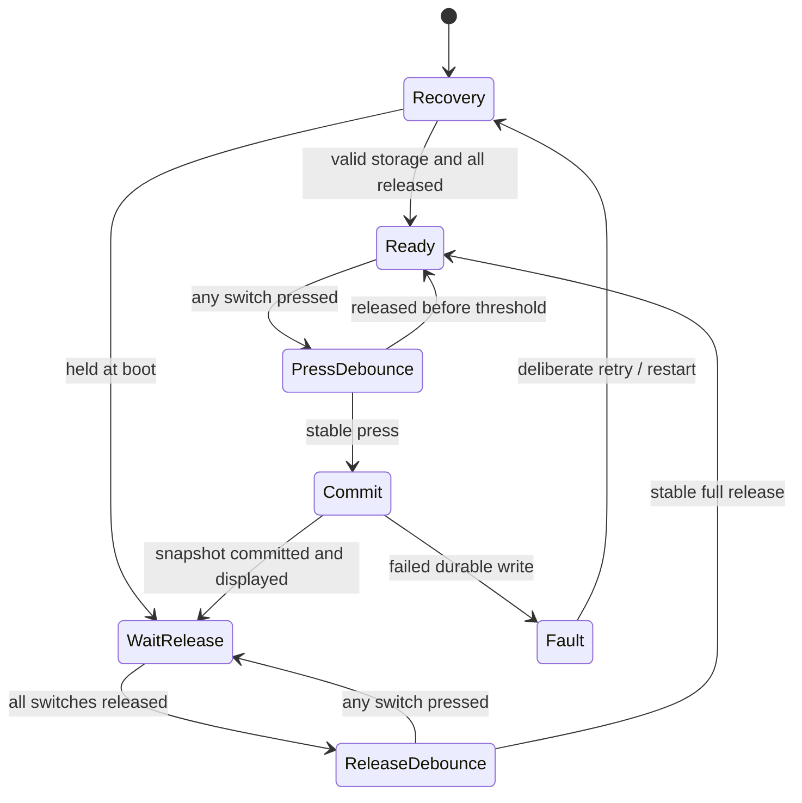

# ESP32-C3 firmware architecture

**Design only: no flashable firmware or verified GPIO assignment.** Prefer C++ on ESP-IDF; PlatformIO may wrap the build after compatible versions are pinned.

## Modules and scheduling

| Module | Responsibility |
| --- | --- |
| Board HAL | GPIO/wake configuration, SPI LCD, I²C FRAM, power sensing |
| Input controller | Main press/release and Undo gestures; deterministic state transitions |
| Counter service | Single writer for sessions, revisions and checked totals |
| Storage service | Dual-copy snapshots, CRC, readback, recovery and bounded slot allocation |
| Display service | Committed count, prompts, error/pending flags, mandatory VCOM schedule |
| Power manager | Idle/sleep decisions, wake capture, low-voltage behavior, radio budget |
| Sync worker | Immutable snapshot queue, HTTPS, persisted acknowledgments and bounded retries |
| Provisioning | Opt-in BLE setup, ownership pairing, credentials and timeout |

GPIO interrupts only capture/wake and enqueue; no network, display transfer or FRAM transaction in an interrupt. A serialized counter task owns state. Network work must not block input or hold its lock during requests. Capture a snapshot under a short lock, then release it before sync. Input overload is an explicit error, not a silent dropped count.

## Main input state machine

Initial debounce candidates: 20 ms stable press and 40 ms stable release, tuned from measured switch traces. Aggregate signal is `any_pressed`.

A 10-second hold must produce only one count. Switch handover while rolling across the plate must not rearm. A button already held at cold boot must be released before counting. A verified GPIO wake from an armed idle state is different: persist arming state before sleep and capture the initial wake press, even if released before initialization ends. Add a hardware latch if the selected wake path cannot reliably capture the minimum supported press.

Undo is recognized on release for a short gesture. Crossing 5 seconds enters reset confirmation without decrement; release then short Undo confirms, main press or 5-second timeout cancels. Require main surface released before accepting confirmation. Serialize simultaneous gestures; if Undo and main activate together, ignore Undo and process main once, except a main press that cancels an open reset prompt is consumed. No button auto-repeat.

## Atomic durable state

Each session record stores format version, device epoch, session ID, monotonic session ordinal, revision, count, closed flag, date/time quality, generation and CRC. Metadata holds device identity/epoch, active session pointer, sequence allocator, cached lifetime and acknowledgment records. Use two copies per record; write the inactive copy, invalidate its marker first, write body + CRC, then write commit marker last and verify by readback. On boot select the highest valid generation. Do not assume multibyte I²C writes or commit markers are intrinsically atomic: CRC and generation must reject partial writes, and fault injection must verify this.

One increment/decrement updates the session revision and count in one record. That committed record is authoritative; cached totals are reconstructed from retained sessions plus the durable archived subtotal described below, rather than updated through an independent transaction. Session close uses a recoverable sequence: commit `closed=true` on old session, allocate/commit its successor, then update active pointer. Boot recovery chooses the valid open successor or creates it using a durably reserved ordinal; never reopen an archived session or generate the same ID for different sessions. Duplicate successor detection and power cuts between every step are acceptance cases.

Display the new count only after the record has passed readback. If storage fails, show a fault and suspend successful counting until recovered; do not pretend an unpersisted increment succeeded. A committed but not yet displayed increment may appear after restart. A cut during an uncommitted physical press cannot be guaranteed to count. Startup exposes corruption rather than silently replacing history with zero.

Use NVS for credentials and infrequent configuration. Reserve a fresh random device epoch on factory reset, so old session IDs/revisions cannot collide; factory erase is a separately guarded maintenance flow, never the normal session reset. Persist cloud acknowledgments in dual-copy records before reclaiming slots. Retry if acknowledgment persistence was interrupted.

Compaction must preserve the device lifetime total: reclaim only a contiguous prefix of closed, acknowledged session ordinals. Commit a dual-copy checkpoint containing epoch, highest archived ordinal and the cumulative archived count before recycling any of those slots. On recovery, lifetime equals that archived subtotal plus retained sessions above the watermark; retained rows below it are excluded, even if power failed before their reclamation. Checkpoint updates add each prefix exactly once using the old watermark. Never advance past an unacknowledged or open session. Test power cuts before/after checkpoint commit and during reuse; otherwise reclaiming cloud-synced history could erase local lifetime progress.

## Power states

Active practice: radios off, input continuously responsive, display maintenance scheduled. Idle: after 60 s with all controls released, choose a measured light/deep sleep implementation with supported wake pins and VCOM service. Do not enter sleep while pressed or while storage commit is in progress. The [ESP-IDF C3 sleep guide](https://docs.espressif.com/projects/esp-idf/en/stable/esp32c3/api-reference/system/sleep_modes.html) defines mode-specific wake constraints; verify against the pinned SDK and selected board rather than borrowing another ESP32 model's APIs.

Sync: attempt bounded association/upload during idle or session close, stop on renewed practice, low battery or budget expiry. Use exponential backoff with jitter (for example 30 s, 2 min, 10 min, then a capped interval); cap total radio-on time per day. BLE: deliberate setup only, time-limited. Physical off: reviewed load isolation; USB behavior must match the final circuit.

At low voltage, finish an in-progress commit while supply remains in specification, disable radios, and warn before brownout. Never rely on a brownout handler alone to save counts. Snapshot storage must already be durable during normal operation. OTA and secure-boot rollout are deferred design work.
