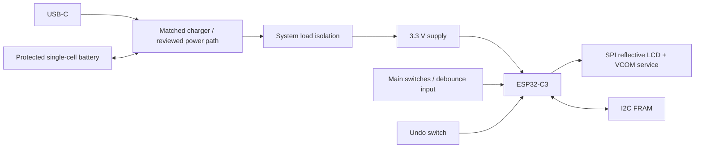

# Hardware candidates and bill of materials

**Planning only. No schematic, procurement, PCB or assembled prototype is supplied.**

## Indicative one-off BOM

EUR allowances prepared 2026-10-08 from the earlier concept budget, broadened for prototype variation. These are not verified live quotations; supplier stock, VAT and regional pricing vary. Quantities and ranges are complete row costs, not per-switch costs.

| Item | Quantity | Candidate / selection constraint | Allowance |
| --- | ---: | --- | ---: |
| MCU board | 1 | Seeed XIAO ESP32C3 with Wi-Fi/BLE; verify exact revision | €8–12 |
| Reflective display | 1 | Sharp Memory LCD breakout, roughly 1.3–1.5 inch; confirm part, resolution and VCOM interface | €25–40 |
| Persistent memory | 1 | I²C FRAM breakout, initial candidate 32 KiB; capacity gate below | €10–18 |
| Main switches | 3–4 | Low-force, quiet momentary switches; test actual force and life | €3–8 |
| Undo control | 1 | Recessed momentary button | €1–3 |
| Power control | 1 | Load-rated slider or slider controlling load switch | €1–3 |
| Battery | 1 | Protected 3.7 V cell, 1,000–2,000 mAh, appropriate connector | €10–20 |
| Interconnect / passives | Set | Wires, protoboard, connectors, pull-ups, decoupling, screws | €10–20 |
| Printed enclosure and soft parts | Set | PETG/PLA, silicone/TPU and rubber feet | €7–15 |
| **Custom-button subtotal** | | Sum of the rows above | **€75–139** |
| Optional arcade reference | 1 | 100 mm button; illumination disabled | +€12–20 |
| Optional power-path circuitry | Set | Charger/load switch/regulator changes if board wiring is unsuitable | +€5–15 |
| Optional sensor comparison | Set | FSR or load cell with suitable acquisition electronics | +€10–30 |

Shipping, tools, test equipment, spare parts, PCB fabrication and cloud/domain charges are excluded. Budget contingency of 20–30% is reasonable before purchasing. Manufacturer specifications must be checked for selected parts; generic names do not establish electrical compatibility.

## Electrical block design

Use switches in parallel to ground on one pulled-up main input for the first build; logical low means any switch is pressed and high means all are released. Separate inputs improve switch diagnostics but consume pins. Use 3.3 V compatible peripherals and short buses, ensure breakout pull-ups do not drive GPIO above its supply. No fixed pin map is approved: review exposed pins, boot straps, debug/USB, SPI, I²C, wake capability and battery-sense needs before soldering.

The [XIAO manufacturer guide](https://wiki.seeedstudio.com/XIAO_ESP32C3_Getting_Started/) documents battery use and board interfaces. An integrated charger is not proof of ideal load sharing, USB-off isolation or charging suitability for every cell. Review schematic, charging current, cell protection, connector polarity and USB/battery back-feed for the exact board. Bench-test first on USB; secure and protect the cell from fasteners, bending, plate loads and heat. Charging must remain within the selected cell's ratings.

## Storage capacity gate

Use fixed-size **session snapshots**, not an unbounded per-press journal, for cloud history. Proposed slots contain two 128-byte copies per session. Reserving 4 KiB for device metadata in 32 KiB FRAM leaves 28 KiB / 256 = **112 session slots**, including the active session. At one new session per day that is roughly 111 closed offline sessions; multiple sessions per day shorten the window. Verify encoded size, allocator overhead and integrity metadata before claiming capacity. Never recycle dirty or unacknowledged slots; increase FRAM capacity if this retention is insufficient.

The MCU's flash/NVS can hold infrequently changed configuration. Do not claim per-press flash durability without endurance and crash-consistency analysis. FRAM avoids flash erase management, but writes across bytes still require an atomic recovery scheme.

## Display and power tradeoff

Memory LCD offers fast reflective updates but must receive polarity inversion according to its exact datasheet. Provide an always-available VCOM source or periodic service with bounded timing; sleeping the MCU indefinitely without display maintenance is not acceptable. Confirm breakout access to EXTCOMIN; many board assumptions depend on the exact model. See [Adafruit's display guide](https://learn.adafruit.com/adafruit-sharp-memory-display-breakout?view=all).

E-paper is an alternative for idle retention, but update latency and visible refresh behavior need testing. A cheap OLED is acceptable for USB bring-up; its power measurements do not validate the intended reflective-display device.

Measure current at the battery input for active, idle, display maintenance, sync, failed association, BLE, off and charging states. Estimate daily charge as sum of current × time, with regulator losses and battery derating, then run endurance trials. Board/chip sleep figures are not assembled-product measurements.
